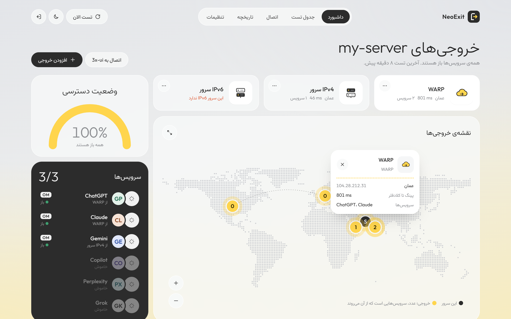
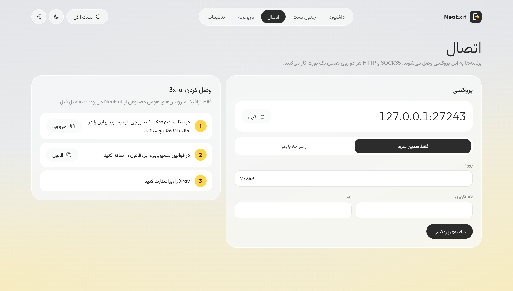
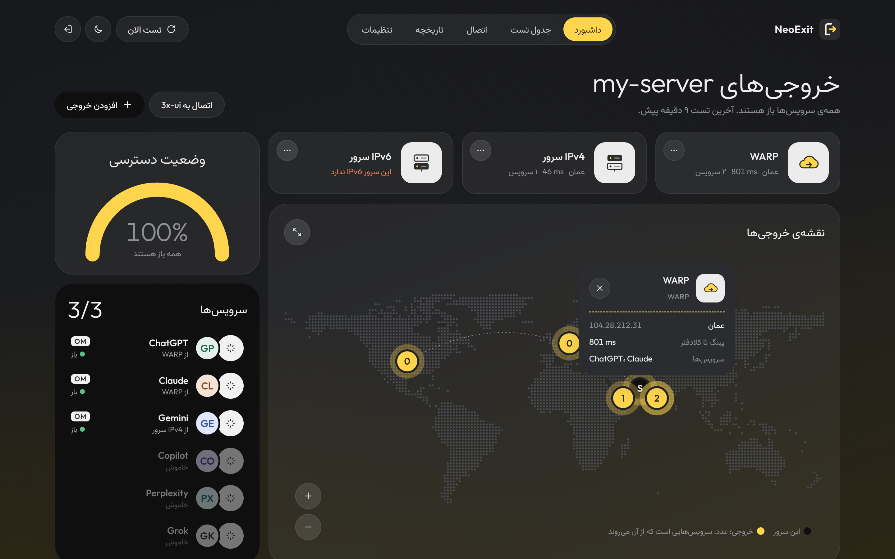

<div dir="rtl">

<h1 align="center">NeoExit</h1>

<p align="center"><b>خروجی رایگان و خودکار برای ChatGPT، Claude و Gemini، روی سرور خودتان</b></p>

<p align="center">
<a href="https://github.com/neoauroraproject/neoexit/releases/latest"></a>

<a href="LICENSE"></a>
</p>

<p align="center"></p>

خیلی از IPهای دیتاسنتر برای سرویس‌های هوش مصنوعی «در کشور شما در دسترس نیست» می‌گیرند. NeoExit روی سرور شما چند خروجی رایگان راه می‌اندازد، هر چند دقیقه همه را با این سرویس‌ها تست می‌کند و هر سرویس را از خروجی‌ای می‌فرستد که الان برایش باز است. اگر خروجی‌ای بسته شد، خودش جابه‌جا می‌کند.

همه‌چیز در یک پورت SOCKS5/HTTP روی همان سرور است؛ کافی است آن را در 3x-ui (یا هر برنامه‌ی دیگر) به‌عنوان خروجی بگذارید.

## نصب

</div>

```bash
curl -fsSL https://raw.githubusercontent.com/neoauroraproject/neoexit/main/install.sh | sudo bash
```

<div dir="rtl">

در پایان، آدرس پنل، نام کاربری و رمز نشان داده می‌شود.

**به‌روزرسانی:** پنل خودش نسخه‌ی تازه را پیدا می‌کند و در تنظیمات با یک دکمه دانلود و نصب می‌کند (فایل با SHA256SUMS همان نسخه بررسی می‌شود). اجرای دوباره‌ی دستور نصب هم برنامه را به‌روز می‌کند. در هر دو حالت تنظیمات می‌ماند.

## خروجی‌ها

| | توضیح |
|---|---|
| **WARP** | حساب رایگان کلادفلر، خودش ساخته می‌شود. اگر بسته شود، خودش IP تازه می‌گیرد. |
| **سایفون** | رایگان، با انتخاب کشور خروجی. |
| **Opera** | پروکسی‌های رایگان مرورگر Opera: اروپا، آسیا یا آمریکا. |
| **SSH** | سرور دیگر خودتان، بی‌آنکه چیزی رویش نصب شود. |
| **IPv4 / IPv6 سرور** | آدرس‌های خود سرور، جدا از هم؛ گاهی فقط یکی بسته است. |
| **SOCKS5 / HTTP** | هر پروکسی دیگری که دارید. |

<p align="center"></p>

## چطور تصمیم می‌گیرد

- هر سرویس روی خروجی فعلی‌اش می‌ماند تا وقتی که باز است؛ جابه‌جایی بی‌دلیل ندارد.
- وقتی لازم شد، اول خروجی‌های **همان کشور قبلی** را امتحان می‌کند، چون عوض شدن پشت سر هم کشور، حساب کاربری را مشکوک می‌کند.
- «کشور را قبول نکرد» را از «IP بسته شده» جدا می‌کند: اولی کشور دیگر لازم دارد، دومی فقط یک IP تازه.
- هر سرویس را می‌شود با یک کلیک روی یک خروجی ثابت کرد.

<p align="center"></p>

## وصل کردن به 3x-ui

**راه ساده:** در 3x-ui به Xray Configs ← Advanced بروید، کل متن را کپی کنید و در بخش «اتصال» پنل NeoExit بچسبانید. تنظیمات آماده برمی‌گردد؛ همان را جایش بگذارید، ذخیره کنید و Xray را ری‌استارت کنید.

- خروجی `neoexit` آخر فهرست می‌نشیند، پس خروجی پیش‌فرض شما همان قبلی می‌ماند.
- قوانین درست بعد از قوانین api و مسدودسازی خودتان می‌نشینند؛ بقیه‌ی تنظیمات دست نمی‌خورد.
- اجرای دوباره، قوانین قبلی NeoExit را عوض می‌کند و چیزی دو بار اضافه نمی‌شود.

**راه دستی:** دو دکمه‌ی کپی هم هست: خروجی را در خروجی‌ها بگذارید (نه اولی)، قانون را بالای قوانین دیگر، و Xray را ری‌استارت کنید.

از آن به بعد فقط ترافیک سرویس‌های هوش مصنوعی از NeoExit می‌رود؛ بقیه مثل قبل.

## روتینگ هوشمند

فهرست دامنه‌ها و IPهای HMray (`hmray.dat` و `hmray-geoip.dat`) داخل NeoExit است. اگر 3x-ui روی همان سرور باشد، با یک دکمه در `/usr/local/x-ui/bin` نصب می‌شود و با هر به‌روزرسانی NeoExit تازه می‌شود؛ وگرنه از پنل دانلودش کنید.

موقع چسباندن تنظیمات Xray، «روتینگ هوشمند» را روشن کنید و برای هر دسته خروجی بدهید: تبلیغات و بدافزار مسدود، سایت‌های ایران مستقیم، بازی، استریم، پیام‌رسان‌ها، برنامه‌نویسی و… به یکی از خروجی‌های خودتان. هوش مصنوعی همیشه از NeoExit می‌رود. برای قوانین دامنه، Sniffing در اینباندها باید روشن باشد.

<p align="center"></p>

## پروکسی‌های بیشتر

در بخش «اتصال» می‌شود هر تعداد پورت SOCKS5/HTTP دیگر ساخت، هر کدام با نام کاربری و رمز خودش:

- **همه از یک خروجی:** همه‌ی ترافیک آن پورت از همان خروجی (مثلاً فقط IPv4، فقط WARP یا فقط سایفون آلمان). اگر آن خروجی قطع شود، ترافیک از راه دیگری نمی‌رود.
- **با روتینگ:** خود پروکسی تصمیم می‌گیرد. برای هر دسته‌ی روتینگ هوشمند (تبلیغات، ایران، تحریم‌کننده‌ها، بازی، استریم، پیام‌رسان‌ها، برنامه‌نویسی، بزرگسالان) مستقیم، مسدود یا یکی از خروجی‌ها را انتخاب کنید و برای بقیه‌ی ترافیک هم یکی. هوش مصنوعی همیشه از خروجی هوشمند خودش می‌رود.

قانون‌های دستی هم مثل 3x-ui هست و قبل از دسته‌ها بررسی می‌شود: دامنه (`example.com`، `full:`، `keyword:`، `regexp:`، `geosite:` از hmray.dat، `ext:geosite.dat:netflix` از `/etc/neoexit/geo` یا پوشه‌ی 3x-ui)، IP یا CIDR (`geoip:`، `ext:`)، پورت، TCP/UDP و تورنت. در هر قانون همه‌ی شرط‌های پرشده باید درست باشند. پروکسی اصلی هم همین روتینگ را دارد، و برای هر پروکسی یک «امتحان» هست که نشان می‌دهد یک دامنه یا IP از کدام قانون و کدام خروجی می‌رود؛ کنار هر قانون هم تعداد اتصال و حجم دیده می‌شود.

اگر برنامه به‌جای دامنه IP بفرستد، NeoExit اسم سایت را از اول اتصال (SNI در TLS، Host در HTTP) پیدا می‌کند. با این حال **Sniffing را در اینباندهای 3x-ui روشن نگه دارید** (و `routeOnly` خاموش) تا خود دامنه برسد.

پروکسی‌ها هیچ‌وقت به آدرس‌های داخلی سرور (`127.0.0.1`، `10.x`، `192.168.x` و…) وصل نمی‌شوند، حتی با دامنه‌ای که به آن‌ها اشاره کند، تا کاربرها به پنل‌ها و سرویس‌های روی سرور نرسند. استثنا را در تنظیمات بنویسید.

با پروکسی «با روتینگ»، در 3x-ui هیچ قانون روتینگی لازم نیست: خروجی Xray آن را اول خروجی‌ها بگذارید تا همه‌ی ترافیک به NeoExit برسد.

UDP هم رد می‌شود (تماس صوتی، بازی، QUIC؛ SOCKS5 UDP ASSOCIATE، که خروجی socks در Xray از آن استفاده می‌کند)، با همان روتینگ TCP. UDP فقط از مسیر خود سرور، IPv4/IPv6 سرور و WARP بیرون می‌رود؛ اگر مقصدش خروجی دیگری باشد (سایفون، Opera، SSH، پروکسی‌های SOCKS5/HTTP) دور ریخته می‌شود و برنامه‌ها معمولاً خودشان به TCP برمی‌گردند.

برای هر کدام لینک `socks5://` و خروجی آماده‌ی Xray (با تگ `neoexit-p1`، `neoexit-p2`، …) کپی می‌شود تا اینباندها یا کاربرهای مختلف 3x-ui را به خروجی‌های مختلف بفرستید.

## نئوتانل

اگر [نئوتانل](https://github.com/neoauroraproject/neotunnel) دارید، صفحه‌ی NeoExit در پنل آن، NeoExit را روی همان سرور و روی هر سرور مقصدی که اضافه کرده‌اید با یک دکمه نصب می‌کند. همه‌ی کارهای این پنل هم از همان‌جا انجام می‌شود: خروجی‌ها، سرویس‌ها، جدول تست، اتصال به 3x-ui، تاریخچه و تنظیمات.

سروری که به گیت‌هاب نمی‌رسد، فایل‌ها را از سرور دیگرتان می‌گیرد. برای این کار NeoExit نسخه‌ی ۱.۴.۰ یا بالاتر لازم است.

## دستورها

</div>

| | |
|---|---|
| `neoexit` | menu: update, password, status, install / repair, uninstall |
| `neoexit update` | install the latest release and restart |
| `neoexit password` | set a new random panel password |
| `neoexit info` | panel address and proxy port |
| `neoexit status` | services and exits, in the terminal |
| `neoexit restart` | restart the service |
| `neoexit uninstall` | remove NeoExit (`--keep-config` keeps the settings) |

<div dir="rtl">

<details>
<summary>حالت تیره</summary>

<p align="center"></p>

</details>

## چند نکته

- WARP کاملاً داخل برنامه اجرا می‌شود؛ هیچ اینترفیس یا مسیری روی سرور ساخته نمی‌شود، پس SSH و برنامه‌های دیگر دست نمی‌خورند.
- برنامه‌ی سایفون جدا اجرا می‌شود و بار اول دانلود می‌شود (کد سایفون GPLv3 است و داخل NeoExit نیست).
- WARP و Opera از API رسمی استفاده نمی‌کنند و ممکن است روزی از کار بیفتند؛ آن وقت خروجی‌های دیگر کار را ادامه می‌دهند.
- پروکسی پیش‌فرض فقط روی همان سرور (`127.0.0.1`) باز است.
- استفاده از این سرویس‌ها از کشوری که پشتیبانی نمی‌کنند، خلاف قوانین خودشان است و ممکن است به بسته شدن حساب برسد.
- پنل پیام‌های تبلیغاتی NeoAurora را از سرور مرکزی می‌گیرد و در صفحه‌هایش نشان می‌دهد. چیزی از سرور شما فرستاده نمی‌شود، جز اسم محصول و جای پیام.
- برای پیدا کردن نسخه‌ی تازه، هر شش ساعت از API گیت‌هاب سؤال می‌شود.

## حق نشر

© ۲۰۲۶ NeoAurora. همه‌ی حقوق محفوظ است. هرگونه کپی‌برداری، تغییر، انتشار دوباره یا فروش این نرم‌افزار یا بخشی از کد آن بدون اجازه‌ی کتبی ممنوع است. نصب و اجرای نسخه‌های رسمی روی سرورهای خودتان آزاد است. متن کامل در [LICENSE](LICENSE).

</div>

<div align="center">

---

### 🌌 NEO AURORA

<p>
  <a href="https://t.me/neoaurora">Telegram</a> &nbsp;·&nbsp;
  <a href="https://t.me/hmraysupport">Support</a> &nbsp;·&nbsp;
  <a href="https://t.me/neolicensebot">License Bot</a> &nbsp;·&nbsp;
  <a href="https://github.com/neoauroraproject">GitHub</a>
</p>

<p>
  <a href="https://t.me/hmpanel">HMPanel Community</a>
  &nbsp;·&nbsp;
  <a href="https://t.me/neotunnels">NeoTunnel Community</a>
  &nbsp;·&nbsp;
  <a href="https://github.com/neoauroraproject?tab=repositories">All Projects</a>
</p>

<br>

### 💖 Support Our Development

<p>
  Your support helps us maintain and improve our open-source projects.
</p>

<p>
  <a href="https://bscscan.com/address/0x94efb6642b8fcc591c28a8c04db2279908f66e18">
    
  </a>
  <br>
  <code>0x94efb6642b8fcc591c28a8c04db2279908f66e18</code>
</p>

<p>
  <a href="https://tonscan.org/address/UQD6NpICg2Q7nF_yFRrKW2_ZgB5LPI1X2KDK0JDjlivwhCJ5">
    
  </a>
  <br>
  <code>UQD6NpICg2Q7nF_yFRrKW2_ZgB5LPI1X2KDK0JDjlivwhCJ5</code>
</p>

<p>
  <a href="https://tronscan.org/#/address/TJsBskCPtbVk6gKxTkcocjJX2qNa62Mo1X">
    
  </a>
  <br>
  <code>TJsBskCPtbVk6gKxTkcocjJX2qNa62Mo1X</code>
</p>

<br>

⭐ **Enjoying this project? Give it a star!**

<p>
  Every star helps us grow and reach more developers.
</p>

**Crafted with ❤️ by the NeoAurora Team**

<sub>© 2026 NeoAurora · All rights reserved · Built with Passion</sub>

---
</div>
