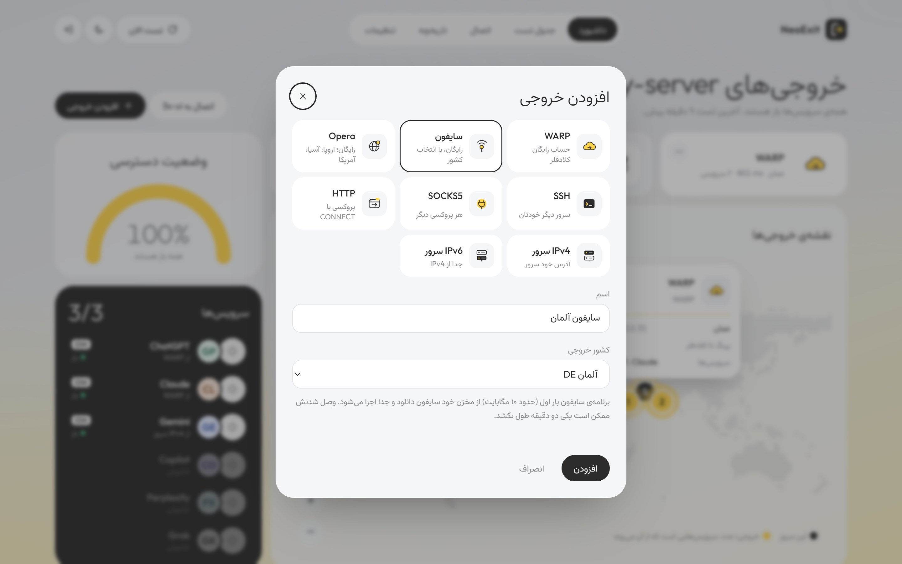
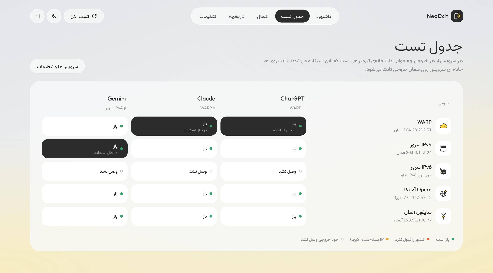

<div dir="rtl">

<h1 align="center">NeoExit</h1>

<p align="center"><b>خروجی رایگان و خودکار برای ChatGPT، Claude و Gemini، روی سرور خودتان</b></p>

<p align="center">
<a href="https://github.com/neoauroraproject/neoexit/releases/latest"></a>

<a href="LICENSE"></a>
</p>

<p align="center"></p>

خیلی از IPهای دیتاسنتر برای سرویس‌های هوش مصنوعی «در کشور شما در دسترس نیست» می‌گیرند. NeoExit روی سرور شما چند خروجی رایگان راه می‌اندازد، هر چند دقیقه همه را با این سرویس‌ها تست می‌کند و هر سرویس را از خروجی‌ای می‌فرستد که الان برایش باز است. اگر خروجی‌ای بسته شد، خودش جابه‌جا می‌کند.

همه‌چیز در یک پورت SOCKS5/HTTP روی همان سرور است؛ کافی است آن را در 3x-ui (یا هر برنامه‌ی دیگر) به‌عنوان خروجی بگذارید.

## نصب

</div>

```bash
curl -fsSL https://raw.githubusercontent.com/neoauroraproject/neoexit/main/install.sh | sudo bash
```

<div dir="rtl">

در پایان، آدرس پنل، نام کاربری و رمز نشان داده می‌شود. اجرای دوباره‌ی همین دستور، برنامه را به‌روز می‌کند و تنظیمات می‌ماند.

## خروجی‌ها

| | توضیح |
|---|---|
| **WARP** | حساب رایگان کلادفلر، خودش ساخته می‌شود. اگر بسته شود، خودش IP تازه می‌گیرد. |
| **سایفون** | رایگان، با انتخاب کشور خروجی. |
| **Opera** | پروکسی‌های رایگان مرورگر Opera: اروپا، آسیا یا آمریکا. |
| **SSH** | سرور دیگر خودتان، بی‌آنکه چیزی رویش نصب شود. |
| **IPv4 / IPv6 سرور** | آدرس‌های خود سرور، جدا از هم؛ گاهی فقط یکی بسته است. |
| **SOCKS5 / HTTP** | هر پروکسی دیگری که دارید. |

<p align="center"></p>

## چطور تصمیم می‌گیرد

- هر سرویس روی خروجی فعلی‌اش می‌ماند تا وقتی که باز است؛ جابه‌جایی بی‌دلیل ندارد.
- وقتی لازم شد، اول خروجی‌های **همان کشور قبلی** را امتحان می‌کند، چون عوض شدن پشت سر هم کشور، حساب کاربری را مشکوک می‌کند.
- «کشور را قبول نکرد» را از «IP بسته شده» جدا می‌کند: اولی کشور دیگر لازم دارد، دومی فقط یک IP تازه.
- هر سرویس را می‌شود با یک کلیک روی یک خروجی ثابت کرد.

<p align="center"></p>

## وصل کردن به 3x-ui

در پنل، بخش «اتصال»، دو دکمه‌ی کپی هست:

1. **خروجی:** در تنظیمات Xray یک خروجی تازه بسازید و این را بچسبانید.
2. **قانون:** در قوانین مسیریابی اضافه کنید.
3. Xray را ری‌استارت کنید.

از آن به بعد فقط ترافیک سرویس‌های هوش مصنوعی از NeoExit می‌رود؛ بقیه مثل قبل.

<p align="center"></p>

## نئوتانل

اگر [نئوتانل](https://github.com/neoauroraproject/neotunnel) روی همان سرور باشد، NeoExit را خودش پیدا می‌کند و وضعیتش را کنار همان سرور نشان می‌دهد.

## دستورها

</div>

| | |
|---|---|
| `neoexit info` | panel address and proxy port |
| `neoexit password` | set a new random panel password |
| `neoexit status` | services and exits, in the terminal |
| `install.sh --uninstall` | remove NeoExit |

<div dir="rtl">

<details>
<summary>حالت تیره</summary>

<p align="center"></p>

</details>

## چند نکته

- WARP کاملاً داخل برنامه اجرا می‌شود؛ هیچ اینترفیس یا مسیری روی سرور ساخته نمی‌شود، پس SSH و برنامه‌های دیگر دست نمی‌خورند.
- برنامه‌ی سایفون جدا اجرا می‌شود و بار اول دانلود می‌شود (کد سایفون GPLv3 است و داخل NeoExit نیست).
- WARP و Opera از API رسمی استفاده نمی‌کنند و ممکن است روزی از کار بیفتند؛ آن وقت خروجی‌های دیگر کار را ادامه می‌دهند.
- پروکسی پیش‌فرض فقط روی همان سرور (`127.0.0.1`) باز است.
- استفاده از این سرویس‌ها از کشوری که پشتیبانی نمی‌کنند، خلاف قوانین خودشان است و ممکن است به بسته شدن حساب برسد.

</div>
